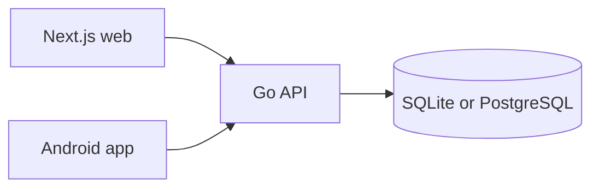

# Inkwell system design

Inkwell lets authors publish serialized stories and readers browse, follow authors, and save stories. I designed the current implementation around a single API and database so the core reading and writing flows are easy to run locally. The larger architecture below is a possible evolution, not a description of services already deployed.

## Current architecture

The Go service handles authentication, stories, chapters, follows, and libraries. SQLite is the default; Docker Compose uses PostgreSQL. The web and Android clients call the same API. Authors can write on the web, while both clients support reading.

The main entities are users, stories, chapters, follows, and library entries. A story belongs to an author and contains ordered chapters. Follow and library records associate readers with authors and stories respectively. Story metadata and chapter bodies are returned separately, keeping catalog responses smaller than they would be if they included every chapter.

The API exposes authentication under `/api/auth`, the catalog under `/api/stories`, the following feed at `/api/feed`, and saved stories at `/api/me/library`. Mutations require authentication and authoring operations check ownership. See the server routes for the complete contract.

## Feed and search

The current feed queries published stories from followed authors, ordered by update time. This keeps the implementation straightforward and returns fresh results without maintaining a separate feed store. Its cost grows with the follow graph and traffic, so I would measure query latency and index usage before changing it.

Search uses SQL substring matching. It is simple to operate but does not provide the relevance, indexing, or language features of a dedicated search engine. If catalog size or query volume justified one, I would maintain a derived search index from publishing events and tolerate a short delay between publication and search visibility.

## Scaling reads and writes

For a larger deployment, I would start by measuring chapter traffic and caching published content where it is safe to do so. Chapter edits would need cache invalidation or versioned keys. Read replicas could reduce load on the primary database, while object storage could hold chapter bodies if their size and operational cost warranted it.

Publishing would remain a durable database operation. If feed updates or indexing moved to background workers, I would use a transactional outbox so an event cannot be lost between the database commit and queue publication. Workers would need retries and idempotent processing.

A larger following feed could use fanout for ordinary authors and merge recent posts from very popular authors at read time. That avoids writing millions of inbox entries for a single publication, at the cost of more complex reads and eventual consistency. The current SQL query avoids that complexity until it is needed.

## Limits and trade-offs

The current service is a single process backed by one database; it has no queue, CDN, cache, or dedicated search service. JWTs are stored in localStorage on the web and SharedPreferences on Android. Before production use, I would revisit session storage, secret management, transport security, backups, and operational monitoring.

I would prioritize changes based on observed bottlenecks: indexes and pagination for growing queries, caching for repeated chapter reads, and asynchronous processing when publishing work becomes too expensive for the request path. These are proposed improvements, not current capabilities.
